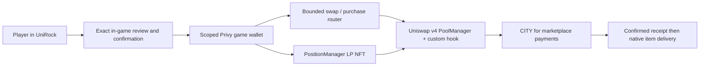

# EthCraft

**A Minecraft city where players use AI workers, buy materials with CITY, and optionally provide liquidity through Uniswap v4.** UniRock is the in-game bank and marketplace in a geographic recreation of South Mumbai. Wallet reviews and confirmations stay inside Minecraft through an explicitly enrolled Privy-managed game wallet.

This repository contains the game, backend, custom contracts, tests and retained evidence. The active economy uses **Unichain Sepolia, chain 1301, and test tokens only**. tUSDC is a six-decimal project mock, not Circle-issued USDC. No real-money, lending, leverage or autonomous investment feature is enabled.

## Start reviewing

- **AI agents and Uniswap judges:** follow [the review guide](docs/UNISWAP_REVIEW.md) and [repository instructions](AGENTS.md). Core checks need no wallet, API keys, Discord account or Minecraft server.
- **Players:** see [the Minecraft walkthrough](#play-the-hosted-minecraft-demo).
- **Integration experience:** [feedback.md](feedback.md).
- **Technical documentation:** [documentation index](docs/README.md).

## Current runtime source

The [source-parity record](evidence/runs/source-parity/142049ac-8fbd-49cc-b516-a272a899b4c2/report.json) verifies **912 tracked non-Markdown runtime/dependency/test files** against the enrolled host checkout at source commit `edb1e6468e57`. Application code and dependency locks match; the publication adds review documentation, CI prerequisites and public deployment metadata. The installed Minecraft plugin matches the latest committed rollout: SHA-256 `f4b1f5bd3d8f87cd6b1cdc86d4f10560b6b0e8627d77a7556a6d54dfb3d3d407`. This is a source/artifact identity check, not a new gameplay or live LP acceptance result.

Private credentials, saved worlds and transaction journals are intentionally excluded. A fresh clone can run the isolated Uniswap checks below; full gameplay needs the operator-provisioned environment. `config/playable-release.json` retains an earlier cutover snapshot; use the linked parity record for the inspected current plugin, without rewriting that historical evidence.

## Why Uniswap is central

CITY is the settlement token for the marketplace. Uniswap provides a real AMM exchange between test USDC and CITY rather than an application-defined conversion rate. A player can request an exact CITY amount with a maximum tUSDC spend, then use CITY for materials or separately approved work. The application also supports a bounded atomic swap-and-equipment-purchase path. Physical item delivery follows the confirmed payment and has its own durable receipt.

Our v4 hook adds application-specific execution checks to the pool. Optional liquidity provision uses real v4 position NFTs, with range selection, token caps, ownership checks, fee accounting and withdrawals. These are contract transactions when confirmed, not simulated balance updates.



### What we built and what we reused

| Component | Role |
| --- | --- |
| [AgentCityMarketplaceHook](contracts/src/AgentCityMarketplaceHook.sol) | Our custom hook: elapsed-time price history, liquidity qualification, pre/post execution limits, bounded dynamic fees and circuit breakers. |
| [BankPaymentRouter](contracts/src/BankPaymentRouter.sol) | Our bounded exact-output and atomic equipment-checkout integration with official v4 callbacks. Its name reflects an earlier prototype; lending is disabled in the active product. |
| [Investment backend](backend/src/investments) | Our SDK-based LP builder, portfolio/fee reads, scoped consent, approvals and restart recovery. |
| [Minecraft investment menu](plugin/src/main/java/org/agentcity/paper/InvestmentMenu.java) | Our native review, confirmation, pending-operation recovery and position actions. |
| Official Uniswap components | PoolManager, PositionManager, V4Quoter, Permit2, v4 core/periphery and SDKs. We reuse these implementations and preserve their notices. |
| Official Uniswap APIs | Chain/pool support checks and allowlisted route comparison. API quotes never authorize arbitrary calldata. |

The pinned SDKs are `@uniswap/v4-sdk` **2.4.6** and `@uniswap/sdk-core` **7.21.0**; contract dependencies are v4-core **1.0.2** and v4-periphery **1.0.3**. See [upstream reuse](docs/UPSTREAM_REUSE.md) and [SDK attribution](docs/THIRD_PARTY_INVESTMENTS.md).

### Current execution routes

- **CITY / tUSDC swaps:** official V4Quoter plus our existing guarded pool/router. Exact output, maximum input, fixed 0.5% investment-swap slippage and deadlines are enforced. The route uses public RPC; no private-ordering or sandwich-immunity guarantee is claimed.
- **Optional LP:** create, increase, collect fees and withdraw through the existing deployed PositionManager, using official SDK liquidity/slippage math. Each action needs its own explicit player confirmation. Material-purchase delegation does not authorize investments.
- **Other pools:** the API advertises chain 1301, but lookup returned no entry for this custom hooked pool and CITY/tUSDC API quotes returned no route. The API registry also references a different v4 deployment. We keep existing pools/NFTs intact. Multi-pool execution stays blocked until each pool, token, target and protected submission route is verified; there is no silent unprotected fallback.

### Pool protections and their limits

The deployed hook maintains a 64-observation ring, sampling at most every 30 seconds. Its reference uses a genuine **300–600-second** historical anchor and rejects stale data. It requires sustained raw active liquidity of at least `1000000000000000`, checks spot/reference deviation before and after execution, limits swap impact to **50 ticks**, spot/reference deviation to **200 ticks**, and effective execution deviation to **2%**. Output caps are **10 tokens per trade** and **20 per block**, separately for each pool currency. LP fees vary between **0.30% and 1.00%**. Pause/health checks can block applicable swaps while retaining LP withdrawal access.

Same-pool averaging is **not an independent fair-value oracle**. Smaller sandwiches, sustained manipulation, adverse selection, impermanent loss and LVR remain possible within these bounds. The raw liquidity floor is not a dollar-depth promise. There is no guaranteed yield, protected principal or zero-MEV claim. [Implementation and custody details](docs/UNIROCK_INVESTMENTS.md#guards-and-custody).

## Deployed contracts: Unichain Sepolia

All addresses below belong to **chain 1301**. Explorer links are for inspection, not a request to transact. [Machine-readable active manifest](config/marketplace-public-deployment.json) includes the PoolKey, source hashes, runtime code hashes and guard constants. Historical deployments remain separately labelled in `contracts/*deployment.json`; their pools are not automatically approved routes.

| Contract we deployed | Address | Purpose |
| --- | --- | --- |
| Marketplace hook | [0x6faf5918c8fd0af9716d300ce8f7e9310cc11fc0](https://sepolia.uniscan.xyz/address/0x6faf5918c8fd0af9716d300ce8f7e9310cc11fc0) | Current CITY/tUSDC v4 checks and dynamic fees. |
| Payment router | [0x6d00ad99e68508cd4cae4fe93eab8b03af8efcaf](https://sepolia.uniscan.xyz/address/0x6d00ad99e68508cd4cae4fe93eab8b03af8efcaf) | Exact-output swaps and atomic equipment checkout. |
| CITY token | [0x13431952927c79004fc2fc5aab576752552fea12](https://sepolia.uniscan.xyz/address/0x13431952927c79004fc2fc5aab576752552fea12) | Project test token, 18 decimals. |
| Mock tUSDC | [0x9caa79a2b1e4420e45f0cf3bd47a90770136b3a4](https://sepolia.uniscan.xyz/address/0x9caa79a2b1e4420e45f0cf3bd47a90770136b3a4) | Project mock, 6 decimals; no dollar backing. |
| StateRegistry | [0x421c5e824038048ae6bc8dc7c19d02b74959112f](https://sepolia.uniscan.xyz/address/0x421c5e824038048ae6bc8dc7c19d02b74959112f) | Expiring world-health attestations. |
| WorldAssetRegistry | [0xf3037a6d2b68ee5832f53d9ff0bf22c22031af81](https://sepolia.uniscan.xyz/address/0xf3037a6d2b68ee5832f53d9ff0bf22c22031af81) | Registered deposited equipment and custody ownership. |
| WorldAssetMarket | [0xb2b515bbbaf0b65a011e1523563601c00fbf0d53](https://sepolia.uniscan.xyz/address/0xb2b515bbbaf0b65a011e1523563601c00fbf0d53) | CITY-priced equipment listings. |
| Work escrow | [0x33f627279ffb9e87253a5635fa76da748a76d050](https://sepolia.uniscan.xyz/address/0x33f627279ffb9e87253a5635fa76da748a76d050) | Separately authorized, bounded work settlement. |

| Uniswap contract reused by this deployment | Address |
| --- | --- |
| PoolManager | [0x9cb26a7183b2f4515945dc52cb4195b0d2d06c95](https://sepolia.uniscan.xyz/address/0x9cb26a7183b2f4515945dc52cb4195b0d2d06c95) |
| PositionManager | [0x12a98709bb5d0641d61458f85dcafbe17ac2d05c](https://sepolia.uniscan.xyz/address/0x12a98709bb5d0641d61458f85dcafbe17ac2d05c) |
| V4Quoter | [0xb2b34025a07af3925313b6b46f8046ee8ffba30b](https://sepolia.uniscan.xyz/address/0xb2b34025a07af3925313b6b46f8046ee8ffba30b) |
| Permit2 | [0x000000000022d473030f116ddee9f6b43ac78ba3](https://sepolia.uniscan.xyz/address/0x000000000022d473030f116ddee9f6b43ac78ba3) |

These are the existing deployed Uniswap implementations used by this project, not a claim that they are the API's current canonical deployment addresses.

**CITY/tUSDC PoolId:** `0x1417774f1f970721329cfb44701537d8bb36296d05a18810cb3771705e590897`. A v4 PoolId identifies state inside PoolManager; it is not a separate pool contract. Currency0 is CITY, currency1 is tUSDC, tick spacing is **60**, and fee flag `8388608` enables dynamic fees. Retained seed position NFT **21** belongs to this pool; older positions **19/20** are preserved.

## Reproduce the Uniswap checks

Use Node **26.3.1+**, npm, Python 3 and Foundry **1.7.1**. The commands below install pinned dependencies and run local fixtures only. They need no credentials or public transactions.

```sh
npm ci --prefix backend --ignore-scripts --no-audit --no-fund
npm ci --prefix contracts --ignore-scripts --no-audit --no-fund
node tests/investments/v4.mjs
node tests/investments/swaps.mjs
node tests/investments/privy.mjs
forge test --root contracts --match-contract '^MarketplaceInvestmentsTest$' -vv
npm ci --prefix tests/compatibility --ignore-scripts --no-audit --no-fund
python3 -m unittest discover -s tests -v
python3 scripts/check_plan.py
```

The Foundry suite uses the actual official PoolManager/PositionManager in an isolated EVM, including a disclosed Permit2 allowance fixture. It covers deposit, increase, fee accrual/collection, full withdrawal, deadline/ownership/minimum-output failures, stale/manipulated prices, thin liquidity, large sandwich front-leg rejection and withdrawal during pause. Node checks cover SDK arithmetic, encoded recipients/caps, quote bounds, allowlist filtering and scoped Privy delegation. Planning checks validate retained requirements and links; they are not product acceptance tests.

The extra compatibility dependency installation supplies the NBT parser used by the Python host-safety tests; it does not launch Minecraft. The [review guide](docs/UNISWAP_REVIEW.md) adds credential-free live chain reads, source navigation, database recovery tests and an evidence checklist. Do not run deployment, funding, delegate-maintenance or native-server upgrade scripts as a review shortcut.

### What is actually verified

| Scope | Evidence and boundary |
| --- | --- |
| Testnet swaps, equipment checkout, native collection and same-operation replay | [Marketplace checkpoint](evidence/MARKETPLACE_CHECKPOINT.json), using disclosed controlled actors and real canonical receipts. |
| Official PositionManager lifecycle and attack/authority checks | [Isolated contract and backend verification](evidence/runs/investments/00d2c901-8bd4-46d7-a3df-ba2057872c41/verification.json); local EVM and provider fixtures, not a human LP deposit. |
| Investment UI expiry, automatic progress and retained signed requests | [Latest review/recovery report](evidence/runs/investment-review-lifecycle/6c7dd9bb-928a-4e36-a6aa-37facfdc7b60/report.json), including isolated native menus and a real read-only quote. |
| New player Privy LP deposit through fees to withdrawal | **Still requires actual owner confirmations and a retained live lifecycle.** Funding alone is not this proof. |
| Protected multi-pool execution | **Unavailable.** Unsupported API routes fail closed. |

The [latest repository review](evidence/runs/uniswap-review/3ba5fa06-a54d-4aa0-bc2e-32ca79b34365/report.json) records a fresh-checkout command run, link/address validation and read-only verification of all 12 listed contract code hashes. It made no public transactions.

Evidence is scoped to its recorded source and environment. This is a test-token prototype, not a security audit or mainnet qualification. Pinned dependencies have recorded transitive audit advisories. Independent-human acceptance and public Minecraft/token platform suitability remain separate, unresolved release requirements. Repository visibility does not establish platform permission.

## Other integrations

| Integration | How EthCraft uses it |
| --- | --- |
| [Privy + Discord](docs/DISCORD_ONBOARDING.md) | Identity linking, approval of the current Minecraft connection and separately scoped managed-wallet signing. Account setup does not fund or authorize an investment. |
| [0G and advanced-model agents](docs/AGENT_SURVIVAL.md) | Objective-driven Survival tools, adaptive model routing and receipt-based advisory review. Models cannot grant financial authority. |
| [Arkiv](arkiv/README.md) | Opt-in public progress, discovery, owner-requested provider handoffs and server-attested two-stage work orders. Public records are not wallet permissions. [Public read-only demo](https://ethcraft-arkiv.quiet-buddy-9104.chatgpt.site). |
| [Voice](docs/VOICE.md) | Simple Voice Chat plus 0G transcription/speech through the same owner-validated tools. Voice cannot confirm investments. |
| [Minecraft + Mumbai](docs/MUMBAI_CITY.md) | Paper plugin, Mineflayer workers, editable Survival city and UniRock service NPCs. [Map attribution](config/mumbai-map.json). |
| [Calculator](docs/CALCULATOR_WORKSHOP.md) | Editable Survival workshop alongside the preserved protected reference and physical verification history. |

## Play the hosted Minecraft demo

A new clone supports the tests above; it does **not** contain private credentials, enrolled wallets, saved worlds or transaction journals. Full gameplay requires an operator-provisioned host, Discord/Privy applications and approved testnet resources. Do not copy secrets into this repository or reset an existing host to make a demo fresh.

On the currently provisioned laptop:

1. Join Minecraft Java **1.21.11** at `127.0.0.1:25596`. In Discord use `/start`, complete the private setup, then `/profile name:<your Minecraft name> login:local`.
2. Stay connected to Minecraft. Use Discord `/join` and approve the **new connection**. Approval must be repeated after reconnects; a reserved name alone is insufficient.
3. In Minecraft type `/mumbai` to visit UniRock. Type `/wallet` for the linked game-wallet balance and `/market` for material selection, quantity, review, CITY payment and collection.
4. Type `/invest` alone, then click **New CITY / tUSDC Position** and a size such as **0.01**. Read all pages and confirm only the exact intended investment. Both tokens plus test ETH for the displayed gas reserve are needed. Funding an external wallet does not fund the separate Privy game wallet.
5. Keep the confirmed operation open; it checks the **same operation** automatically. Use **Resume Latest Investment** after closing it. An expired unsigned quote requires a new review and consent. Never create another order to recover a delayed one.
6. Open the resulting NFT for add, fee collection or withdrawal reviews. Each is a new, separate confirmation. For agents, use `/agent agent task <objective>` or `/agent 0g task <objective>`. Their approved material-shopping permission cannot invest.

Commands are typed alone; menu labels and navigation arrows are not part of a command. [Full LP/swap usage and recovery](docs/UNIROCK_INVESTMENTS.md).

## Repository map and provenance

`contracts/` holds Solidity and public deployment records; `backend/` holds services; `plugin/` holds the Paper integration; `scripts/` holds explicitly scoped operator/test tools; `tests/` and `evidence/` hold checks and retained results. `config/` holds public settings; private host state stays ignored under `.local/`.

AgentCity remains in internal namespaces, source filenames and historical evidence. AI assisted implementation, testing and documentation. Existing project-specific code/assets are retained; a new repository or condensed history does not make them newly created for a prize track. Original source documents, qualification requirements, failed evidence and third-party notices remain intact. See [the documentation index](docs/README.md) for the retained research plan and component licenses.
